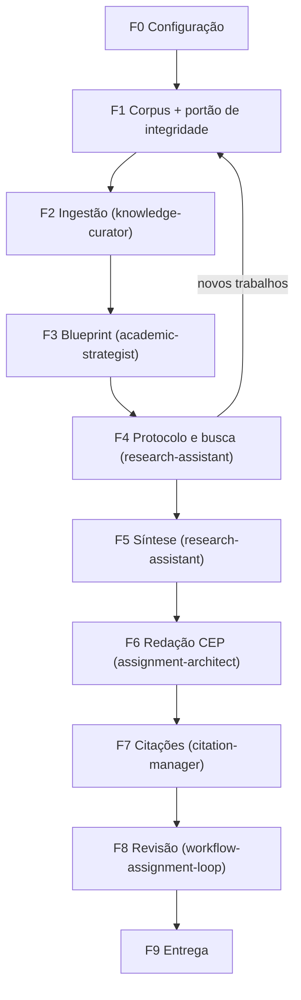

# Workflow: Pesquisa Científica (PUB / IC / TCC / Artigo)

## Visão geral

Este workflow amarra skills já existentes num ciclo de pesquisa com **estado persistente**,
para que qualquer agente (inclusive modelos menores) consiga retomar o trabalho do ponto exato
em que parou. Ele NÃO substitui as skills especialistas: ele diz **qual skill chamar, com quais
entradas, o que salvar, quando parar e como saber que terminou**.



## Dependências

| Skill / ferramenta | Usada em |
|--------------------|----------|
| `knowledge-curator` | F1 (só a lista de referências do documento-base), F2 |
| `academic-strategist` | F3 |
| `research-assistant` | F4, F5 |
| `scientific-research-specialist` | F4 (questões de pesquisa), F6 (rigor IMRaD), F8 (parecer de pares) |
| `assignment-architect` | F6 |
| `citation-manager` | F7 |
| `workflow-assignment-loop` + `academic-reviewer` | F8 |
| `literature-search-openalex` / `literature-search-arxiv` (opcionais) | F1, F4 |
| `.agents/tools/corpus_integrity_check.py` | F1 (portão obrigatório), F4 (após cada rodada) |

## Convenções obrigatórias

1. **Caminhos**: todos os caminhos deste workflow são **relativos à raiz do workspace** (a pasta
   que contém `.agents/`). As regras globais citam `<LOCAL_PATH>`; se esse
   caminho não existir na máquina, use a raiz do workspace atual. Nunca crie uma árvore paralela.
2. **Identificadores** (definidos na F0 e gravados no estado):
   - `{discipline_id}`: pasta-mãe na memória (ex.: `pub`).
   - `{research_id}`: a pesquisa (ex.: `grafos_conhecimento`).
   - `{assignment_id}`: o entregável (ex.: `levantamento_bibliografico`).
   - `{raw_dir}`: pasta de materiais brutos (ex.: `PUB/`).
3. **Onde salvar cada coisa** (conforme `academicos_storage.md`):

   | Artefato | Caminho |
   |----------|---------|
   | Estado do workflow | `_academicos_memory/research_repository/{discipline_id}/{research_id}/workflow_state.json` |
   | Manifesto + relatório de integridade | `_academicos_memory/research_repository/{discipline_id}/{research_id}/corpus_manifest.json` e `corpus_integrity_report.md` |
   | Protocolo, log de buscas, síntese | `_academicos_memory/research_repository/{discipline_id}/{research_id}/` (`protocol.md`, `search_log.md`, `comparative_table.md`, `state_of_art.md`, `gap_analysis.md`, `bibliography.json`) |
   | Base de conhecimento | `_academicos_memory/discipline_knowledge_base/{discipline_id}/` |
   | Blueprint | `_academicos_memory/academic_success_blueprint/{discipline_id}/strategy_blueprint.md` |
   | Entregável | `_academicos_memory/assignment_repository/{discipline_id}/{assignment_id}/` |
   | Revisões | `_academicos_memory/evaluation_repository/{discipline_id}/{assignment_id}/` |
   | PDFs do corpus | `{raw_dir}/Material de apoio/papers/` (ou o `corpus_dir` do manifesto) |

4. **Estado persistente**: no INÍCIO de todo turno, leia `workflow_state.json`; no FIM de todo turno,
   atualize `current_phase`, `current_step`, as listas `done` e `next_action`. Se o arquivo não
   existir, você está na F0. Se `next_action` existir, execute exatamente ela.
5. **Pontos de parada** (🛑): ao encontrar 🛑, reporte ao usuário o que foi feito, o que vem a seguir
   e **pare de chamar ferramentas**. Não avance sem resposta.
6. **Python**: sempre `.\.venv\Scripts\python.exe`. Para HTTPS, use
   `import truststore; truststore.inject_into_ssl()` (usa os certificados do Windows, inclusive a
   CA corporativa). **Nunca** desative a verificação TLS (`ssl._create_unverified_context`, `verify=False`).
7. **Zero jargão interno** no entregável (P10 das regras globais).

---

## F0 — Configuração (1 turno)

**Entrada**: pasta da pesquisa indicada pelo usuário.

1. Liste recursivamente `{raw_dir}` e conte as páginas de cada PDF (`pypdf`). Apresente o inventário em tabela.
2. Pergunte ao usuário (use `ask_question`, uma única vez, com todas as perguntas):
   - Tipo de entregável: levantamento bibliográfico/estado da arte | relatório de atividades | artigo | projeto.
   - Documento-base cujas referências semeiam o corpus (ex.: projeto do colega/orientadora).
   - Norma de citação: ABNT (padrão em português) | APA | IEEE | ACM.
   - Idioma, nome do(a) orientador(a), prazo.
   - Se haverá busca nova (F4) ou só análise do corpus semente.
3. Crie `workflow_state.json` a partir de `templates/workflow_state.template.json`, preenchendo tudo.
   Registre cada resposta em `decisions`.
4. 🛑 Mostre os identificadores escolhidos e o caminho do estado.

**Pronto quando**: `workflow_state.json` existe, sem nenhum `<placeholder>`.

---

## F1 — Aquisição do corpus e portão de integridade

**Objetivo**: ter, em disco, o arquivo **certo** de cada referência, e saber quais referências do
documento-base estão citadas de forma errada.

1. **Extrair referências**: atuando como `knowledge-curator` (escopo restrito à seção de Referências),
   extraia o texto do documento-base e copie cada referência **literalmente** para `cited_as`.
2. **Resolver metadados oficiais** de cada referência, nesta ordem: DOI no próprio texto →
   OpenAlex (`https://api.openalex.org/works?search=<título>`) → `search_web`. Preencha `title`,
   `authors`, `year`, `venue`, `doi` com os dados **oficiais** (não com os do documento-base).
3. **Classificar acesso**: `open` (arXiv, Open Access, página do autor), `institutional` (paywall),
   `public_document` (órgão público), `unavailable`.
4. **Baixar** os `open` para `corpus_dir`, nome `{Sobrenome}_{Ano}_{Titulo_Curto}.pdf`.
   - ⚠️ **Nunca adivinhe IDs do arXiv ou URLs.** Só use URLs devolvidas pelo OpenAlex
     (`open_access.oa_url`, `locations[].pdf_url`), pela página da editora ou por um resultado de busca.
   - Confira se o `Content-Type` é `application/pdf` antes de salvar.
5. **Itens `institutional`**: entregue ao usuário uma lista com link DOI + link da editora + nome de
   arquivo sugerido. Ele baixa com VPN USP / Portal CAPES. Depois, mova/renomeie os arquivos que ele
   salvou (procure também na pasta-mãe, ele pode ter salvo fora de `papers/`) e preencha `file`.
6. **Rodar o portão (obrigatório)**:
   ```powershell
   .\.venv\Scripts\python.exe .agents/tools/corpus_integrity_check.py _academicos_memory/research_repository/{discipline_id}/{research_id}/corpus_manifest.json --online
   ```
   | Exit | Significado | Ação |
   |------|-------------|------|
   | 0 | APROVADO | Avance para a F2 |
   | 1 | REPROVADO: arquivo é outra obra, ou DOI/citação divergente | Apague o arquivo errado e obtenha o certo; se for substituto legítimo ou divergência confirmada, preencha `acknowledged` com a justificativa e a evidência. Rode de novo. |
   | 2 | PENDENTE: faltam arquivos | Aguarde o usuário ou, com a concordância dele, preencha `waived`. Rode de novo. |
7. **Divergências de citação**: registre cada uma em `citation_discrepancies` (é informação útil para
   o autor do documento-base e para a orientadora).
8. 🛑 Mostre a tabela do `corpus_integrity_report.md`, os itens pendentes e as divergências.

**Pronto quando**: o portão retorna 0 e o estado tem `F1_corpus.gate_exit_code = 0`.

---

## F2 — Ingestão na base de conhecimento (1 arquivo ou bloco por turno)

Execute a skill `knowledge-curator` com `{disciplina_id} = {discipline_id}`, respeitando o CEP dela
(1 arquivo por turno, append nunca overwrite, 🛑 ao fim de cada turno).

1. **Montar a fila** (`F2_ingestao.queue`) nesta ordem:
   1. documentos de orientação (atas, e-mails, diretrizes da orientadora);
   2. projeto da orientadora e documento-base;
   3. papers semente com maior relação com o domínio do projeto;
   4. surveys;
   5. livros.
2. **Fatiamento**: PDF com mais de 30 páginas → blocos de 15 páginas (cada bloco é um item da fila).
3. **Livros (leitura dirigida)**: ingira primeiro o sumário. Proponha ao usuário os capítulos
   relevantes para as questões de pesquisa. 🛑 Os capítulos não selecionados vão para
   `skipped_with_user_decision` e para o `ingestion_report.md` como
   "não ingerido por decisão do usuário em {data}" (isso mantém a regra "nenhum material ignorado" honesta).
4. **Adaptações para pesquisa** (além dos 13 arquivos padrão da DKB):
   - `paper_cards.md`: uma ficha por trabalho, usando `templates/paper_card.template.md`.
     Metadados vêm do manifesto, nunca de `cited_as`.
   - `professor_expectations.md` → expectativas do(a) **orientador(a)** (evidências das atas e do projeto dele/dela).
   - `evaluation_criteria.md` → sem rubrica formal, todos os critérios são "Inferido", com evidência.
5. No fim de cada turno: mova o item de `queue` para `done`, atualize `next_action`, 🛑.
6. Último turno: Passos 11–13 do curator (`source_mapping.json`, `references.md`, `ingestion_report.md`).

**Pronto quando**: `queue` vazia e os 13 arquivos + `paper_cards.md` existem e não estão vazios.

---

## F3 — Blueprint da pesquisa

1. Execute `academic-strategist` para `{discipline_id}`. Interprete "professor" como **orientador(a)**
   e "nota" como **aceitação do relatório pelo(a) orientador(a) e qualidade publicável**.
2. O blueprint deve conter no mínimo: questões que o entregável precisa responder; critérios de
   qualidade científica inferidos (com evidência e confiança); anti-padrões; formato esperado.
3. 🛑 Peça ao usuário para validar (ele conhece a orientadora melhor que qualquer inferência).

**Pronto quando**: `strategy_blueprint.md` existe e o usuário validou (registrar em `decisions`).

---

## F4 — Protocolo e busca (pule se o usuário decidiu analisar só o corpus semente)

1. Com `research-assistant` + `scientific-research-specialist`, preencha
   `templates/research_protocol.template.md` → `protocol.md`. As questões de pesquisa devem
   sair do blueprint e do projeto, com a origem citada.
2. 🛑 Usuário aprova o protocolo (idealmente após mostrar à orientadora).
3. **Execução**:
   - O agente executa nas fontes abertas por API (OpenAlex, DBLP, arXiv) e o snowballing via
     OpenAlex (`filter=cites:<id>` para forward; `referenced_works` para backward).
   - O usuário executa nas fontes com login ou interface web (IEEE Xplore, ACM DL, Scopus, Google
     Scholar, Consensus, Scholar Labs) e salva as exportações em `{raw_dir}/Material de apoio/buscas/`.
     **Não** automatize essas interfaces nem tente contornar login ou CAPTCHA.
4. **Triagem**: deduplique por DOI e depois por título normalizado; aplique CI/CE em título e
   resumo; registre números em `search_log.md` (tabela estilo PRISMA: identificados → sem
   duplicatas → triados → elegíveis → incluídos).
5. Incluídos entram no manifesto com `role: "search"` ou `"snowball"`; volte à F1 (passos 2–7)
   e à F2 só para os novos itens.
6. Incremente `F4_protocolo_busca.rounds`. Pare ao atingir `max_rounds` ou quando uma rodada
   trouxer menos de 3 incluídos novos (saturação).

**Pronto quando**: protocolo aprovado, `search_log.md` com todas as rodadas, portão da F1 com exit 0.

---

## F5 — Síntese da literatura (CEP: 1 eixo temático por turno)

1. Defina os eixos temáticos a partir das fichas (`paper_cards.md`) e das questões de pesquisa.
   Registre em `F5_sintese.subthemes`. 🛑 Usuário confirma os eixos.
2. Para cada eixo, num turno separado, escreva a seção correspondente em `state_of_art.md`:
   mínimo de 500 palavras, ao menos 3 trabalhos, síntese crítica (consensos, divergências,
   evolução), sem lista de autores.
3. Turnos separados para: `comparative_table.md` (Trabalho | Modelo de dados | Técnica |
   Dados/domínio | Avaliação | Limitações | Relação com o projeto) e `gap_analysis.md`
   (lacuna | evidência | relevância | relação com os objetivos do projeto).
4. `bibliography.json`: exporte os itens OK/RECONHECIDOS do manifesto.

**Pronto quando**: todos os eixos + tabela + gaps existem e cumprem a densidade.

---

## F6 — Redação do entregável (CEP)

1. Execute `assignment-architect` com `{disciplina_id} = {discipline_id}` e `{assignment_id}`.
   Pré-requisitos dele: DKB (F2), ASB (F3) e enunciado. Na pesquisa, o "enunciado" é a combinação
   de: decisão da F0 + blueprint + protocolo. Salve isso como `briefing.md` na pasta do assignment.
2. **Estrutura padrão do levantamento bibliográfico** (ajuste ao blueprint):

   | # | Seção | Fonte principal | Mín. palavras |
   |---|-------|-----------------|---------------|
   | — | Identificação (nome, NUSP, orientador(a), programa, data ISO) | regras globais | — |
   | — | Resumo + palavras-chave | todas | 150 |
   | 1 | Introdução: contexto, objetivo do levantamento, questões de pesquisa, organização | projeto, blueprint | 400 |
   | 2 | Método do levantamento: protocolo, fontes, strings, critérios, fluxograma PRISMA | `protocol.md`, `search_log.md` | 400 |
   | 3 | Fundamentação conceitual (definições formais usadas no restante) | `definitions.md`, `concepts.md` | 600 |
   | 4 | Estado da arte, uma subseção por eixo | `state_of_art.md` | 500 por eixo |
   | 5 | Análise comparativa: tabela + diagrama de taxonomia | `comparative_table.md` | 400 |
   | 6 | Lacunas e oportunidades para o projeto | `gap_analysis.md` | 400 |
   | 7 | Considerações finais e próximos passos | todas | 300 |
   | — | Referências | `bibliography.json` | — |

   O fluxograma PRISMA e o diagrama de taxonomia são obrigatórios: são úteis ao leitor e dão ao
   `diagram-reviewer` um objeto real de avaliação.
3. Gere o `expansion_plan.md`. 🛑 Usuário aprova.
4. Um fragmento por turno; atualize o status no plano e em `F6_redacao.done`.
5. **Regra de citação**: só cite itens do manifesto com status OK, OK_COM_AVISOS ou RECONHECIDO,
   usando os metadados oficiais. Toda afirmação de resultado tem página da fonte na ficha.
6. Consolide em `draft_v1.md` e crie `metadata.json` (formato da skill `assignment-architect`).

---

## F7 — Auditoria de citações

1. Execute `citation-manager` na norma da F0 sobre `draft_v{N}.md`.
2. Verificações obrigatórias: toda citação no texto tem referência; toda referência é citada; todo
   item referenciado existe no manifesto; ano/autores batem com os metadados oficiais (não com `cited_as`).
3. Corrija no próprio draft (novo número de versão se houver mudança de conteúdo).

---

## F8 — Revisão e melhoria

1. Execute `workflow-assignment-loop` (nota de corte 9.8, máximo 5 iterações) sobre o assignment.
   O portão `qa_code_metric_gates.py` roda como determina o loop; registre a saída mesmo quando não
   houver código.
2. Opcional, recomendado para artigo: peça ao `scientific-research-specialist` um parecer de revisão
   por pares e salve em `evaluation_repository/{discipline_id}/{assignment_id}/peer_review_v{N}.md`.
3. Registre as notas em `F8_revisao.scores`.

---

## F9 — Entrega

1. Exporte para o formato pedido (`.docx`/`.pdf`; Pandoc se disponível, senão `python-docx`).
2. Auditoria pós-compilação (regra 6 de `academicos-execution.md`): extraia o texto do arquivo
   gerado e confira tabelas, diagramas e fórmulas renderizados, sem Markdown cru.
3. Copie para `assignment_repository/{discipline_id}/{assignment_id}/entregaveis_finais/` sem
   sobrescrever versões anteriores.
4. Gere `loop_evolution_report.md`, marque todas as fases como `done` e 🛑 apresente o arquivo final.

---

## Retomada por outro agente

1. Leia `workflow_state.json` da pesquisa.
2. Execute `next_action`. Se estiver vazio, vá para a primeira fase com `status != "done"`.
3. Antes de escrever qualquer coisa na F5/F6, rode o portão da F1 de novo (o usuário pode ter
   adicionado ou trocado PDFs). Se aparecerem arquivos novos em `{raw_dir}`, siga a regra
   Auto-Sync de `academicos-execution.md`.

## Erros comuns (todos já aconteceram)

| Erro | Consequência | Prevenção |
|------|--------------|-----------|
| Adivinhar um ID do arXiv | PDF de outro artigo salvo com nome certo | Passo F1.4 + portão |
| Confiar nas referências do documento-base | Autores/volume errados propagados para o relatório | `cited_as` ≠ metadados oficiais; portão `--online` |
| Aceitar arquivo "parecido" (mesmo autor, outro título) | Citação de obra que não foi lida | Contiguidade do título no portão; `acknowledged` só com justificativa |
| Desativar verificação TLS para baixar | Risco de segurança | Convenção 6 (`truststore`) |
| Ingerir vários arquivos num turno | Base rasa | CEP do curator + 🛑 |
| Redigir antes do blueprint validado | Texto desalinhado com a orientadora | F3 🛑 |
| Deixar arquivo do usuário fora de `corpus_dir` | Portão acusa ausente | F1.5: procurar na pasta-mãe |

