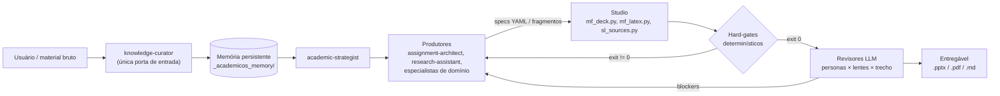

# GenAI Content Pipeline: AcademicOS + Studio

> **Rascunho.** Primeira versão do README, ainda a revisar.

Este repositório reúne um sistema multiagente que produz conteúdo acadêmico e técnico: relatórios, apresentações, documentos LaTeX e revisões bibliográficas. Ele foi pensado para rodar com um LLM de janela de resposta curta (Gemini no Antigravity IDE) e mesmo assim entregar documentos longos e confiáveis.

A ideia central é que **o modelo nunca escreve o arquivo final**. O LLM só preenche especificações curtas e validáveis, como YAML e fragmentos de texto. Scripts Python determinísticos montam, renderizam e auditam o resultado.

## Impacto

Eu uso o pipeline no dia a dia de uma rotina com trabalho, iniciação científica e 20–27 h semanais de disciplinas.

| Tipo de entrega (semestre) | Qtd. | Sem o pipeline (estimativa) | Com o pipeline | Economia |
|---|---|---|---|---|
| Lista de análise de dados (Excel + Python + gráficos + relatório) | 4 | 6–8 h cada | 13–70 min cada (medido), ≈ 2,4 h no total | **≈ 22–30 h** |
| Relatório técnico de teste de software | 3 | 5–6 h cada | ≈ 1 h cada* | ≈ 12–15 h |
| Entrega de slides de projeto em grupo | 3 | ≈ 5 h por pessoa (grupo de 5) | ≈ 1 h* | ≈ 12 h minhas (até ≈ 20 h-pessoa do grupo por entrega) |
| **Total** | **10** | | | **≈ 45–55 h no semestre** |

\* Tempo de execução não registrado nos artefatos. É uma estimativa conservadora, baseada nas entregas medidas.

A revisão também é automatizada. Agentes revisores (acadêmico, de conteúdo, didático, de formato e de diagramas) e portões determinísticos de números e visual corrigem o material em loop até ele atingir a nota-alvo. Foram cerca de 28 rodadas de revisão registradas no semestre. A versão de pesquisa leva a mesma lógica para relatórios científicos, com portões que verificam fontes e números antes da revisão.

## Arquitetura



| Camada | Pasta | Papel |
|---|---|---|
| **AcademicOS** | `.agents/` | Agentes do Antigravity: 43 skills (produtores, revisores, workflows), 5 regras globais e as tools Python de verificação |
| **Studio** | `studio/` | Motor de produção compartilhado: Material Factory (`mf-`), Source Library (`sl-`), Review Engine (`rep-`) e o piloto automático `studio-next` |

## Decisões de design

1. **Spec primeiro, render por script.** Contornar o limite de cerca de 1200 palavras por resposta: o LLM preenche campos curtos e o script cuida de layout, ajuste de texto e compilação.
2. **Produção fragmentada (CEP).** Todo documento longo segue a sequência plano de expansão → fragmentos → consolidação → harmonização.
3. **Nada inventado.** Todo fato precisa vir de uma fonte catalogada (`SRC-x#Cxxxx`). Quando falta um dado, o modelo escreve `[[PENDENTE: ...]]`, e o QA bloqueia a entrega.
4. **Gates determinísticos antes da revisão LLM.** A integridade do corpus é checada contra os PDFs e o OpenAlex. Os números das tabelas são conferidos contra os logs brutos. Há também gates geométricos e de contraste para os slides.
5. **"Anti-teatro" na revisão visual.** O gate desenha um código canário nos pixels da prancha de QA. O revisor multimodal só é aprovado se devolver esse código, o que prova que ele de fato olhou a imagem.
6. **Revisão por personas calibráveis.** São 20 personas e 15 lentes, combinadas em 13 painéis. A calibração mede recall e precisão contra feedback real.
7. **Estado persistente e retomável.** Agentes conversam só por artefatos em disco. `studio_next.py` e o `workflow_state.json` dizem o próximo passo exato, então até um modelo menor consegue retomar o trabalho.

## Como rodar

```bash
python -m venv .venv && .venv/Scripts/pip install -r requirements.txt   # TODO: gerar requirements enxuto
python studio/scripts/studio_doctor.py        # diagnóstico do ambiente
python studio/scripts/tests/run_tests.py      # 11 testes automáticos
```

Exemplos prontos estão em `studio/examples/`: um deck com os 22 arquétipos de slide e uma apostila em LaTeX.

## Outros projetos: P&D em roteamento no Instituto Eldorado

Os projetos abaixo foram descontinuados pela empresa e são publicados com autorização. Os dados reais de clientes não fazem parte de nenhum repositório.

| Projeto | Problema | O que construí | Repositório |
|---|---|---|---|
| **Gerador de grafos de entrega** | Criar instâncias de roteamento realistas (pesos da rua, não distância em linha reta) para qualquer cidade | A partir de um CD e de pontos de entrega, gera o grafo dirigido da malha viária (OSRM/OSM), resolve as rotas com OR-Tools (CVRPTW) e mostra tudo num painel sobre o mapa | [delivery-graph-builder](https://github.com/marcosreballo-source/delivery-graph-builder) |
| **Crawler de tempos de trajeto** | Medir quanto a mesma viagem custa em cada horário, sem estourar o custo da API do Google Maps | Coleta 24 h por semanas via Routes API, com cache, trava de orçamento e janelas de pico. Roda numa VM ou em Slurm + Apptainer | [route-time-crawler](https://github.com/marcosreballo-source/route-time-crawler) |
| **smlaunch** | Treinos em AWS SageMaker sem padrão de lançamento, versionamento e controle de custo | Framework com CLI para lançar, acompanhar, baixar artefatos, importar no MLflow e auditar custos a partir de um YAML. 29 testes | [sagemaker-training-launcher](https://github.com/marcosreballo-source/sagemaker-training-launcher) |
| **QGAT** | Heurísticas de roteamento aprendidas com redes neurais híbridas clássico-quânticas | Graph Attention com camadas quânticas (PennyLane) treinado por RL, com 49 configs de ablação | [quantum-routing-research/qgat](https://github.com/marcosreballo-source/quantum-routing-research/tree/main/qgat) |
| **QAOA multiobjetivo** | Equilibrar vários objetivos (distância, tempo, custo) em TSP/VRP | Formulações QUBO multiobjetivo e execuções em hardware IBM | [quantum-routing-research/qaoa-multiobjective](https://github.com/marcosreballo-source/quantum-routing-research/tree/main/qaoa-multiobjective) |
| **Gêmeo digital de hub** (proposta) | A escolha da localização de hubs dependia de parâmetros pouco confiáveis para a área de negócios | Levantamento de requisitos e de dados para um gêmeo digital com custos fiscais e de frota | sem código |


### Publicações

- *A hybrid quantum-classical neural network for learning to route*: [arXiv:2609.00489](https://arxiv.org/abs/2609.00489) (2026)
- *Quantum Approximate Multi-Objective Optimization in Routing Problems*: [arXiv:2610.00168](https://arxiv.org/abs/2610.00168) (2026)
- *Evaluating Parameter Transfer in FALQON Across Graph Families*: SBCCQ 2026, [DOI 10.5753/sbccq.2026.23365](https://doi.org/10.5753/sbccq.2026.23365)
- *Sparse Walsh-Pauli Correlation Encoding for MaxCut*: [arXiv:2609.08907](https://arxiv.org/abs/2609.08907) (2026)

ORCID: [0009-0003-6396-9302](https://orcid.org/0009-0003-6396-9302)

## Estado

- Studio implantado até a etapa S01 (ferramentas, skills e primeiros .pptx/PDF reais). As etapas S02 a S08 estão em andamento.
- Workflow de pesquisa científica v1 (F0–F9) em uso, com o gate de integridade do corpus. A v2 (Hub-and-Spoke) está em especificação.
